# IIIT BHUBANESWAR – MESS MANAGEMENT SYSTEM
## Relational Database Schema Documentation

### Overview
The database engine is **SQLite** (using `better-sqlite3`), running in **WAL (Write-Ahead Logging)** mode with strict foreign key constraints enabled (`PRAGMA foreign_keys = ON;`). This ensures ACID compliance, high concurrent read/write throughput, and zero external database configuration requirements.

The database file resides locally at `data/mess.db` and persists automatically between application restarts.

---

### Entity Relationship Diagram (Mermaid)

```mermaid
erDiagram
    users ||--o{ menus : "creates"
    users ||--o{ meal_attendance : "marks/attends"
    users ||--o{ feedback : "submits"
    users ||--o{ complaints : "raises/assigned"
    users ||--o{ bills : "billed to"
    users ||--o{ payments : "pays/records"
    users ||--o{ expenses : "logs"
    users ||--o{ announcements : "publishes"
    users ||--o{ notifications : "receives"

    menus ||--|{ menu_items : "contains"
    bills ||--|{ bill_items : "comprises"
    bills ||--o{ payments : "settled by"

    users {
        int id PK
        string student_id UK
        string full_name
        string email UK
        string password_hash
        string role "student | admin | staff"
        string department
        int year_of_study
        string hostel_room
        string phone
        int is_active
        datetime created_at
        datetime updated_at
    }

    menus {
        int id PK
        string date "YYYY-MM-DD"
        string meal_type "breakfast | lunch | dinner"
        string title
        string serving_time
        int is_special
        int created_by FK
        datetime created_at
    }

    menu_items {
        int id PK
        int menu_id FK
        string item_name
        string category
        int is_veg
    }

    meal_attendance {
        int id PK
        int student_id FK
        string date
        string meal_type
        string status "present | absent"
        int marked_by FK
        datetime marked_at
    }

    feedback {
        int id PK
        int student_id FK
        string date
        string meal_type
        int food_quality_rating "1-5"
        int taste_rating "1-5"
        int hygiene_rating "1-5"
        int quantity_rating "1-5"
        int overall_rating "1-5"
        text comments
        datetime created_at
    }

    complaints {
        int id PK
        string ticket_number UK
        int student_id FK
        string category
        string subject
        text description
        string priority "Low | Medium | High | Urgent"
        string status "Submitted | Under Review | In Progress | Resolved | Rejected"
        int assigned_to FK
        text resolution_notes
        datetime created_at
        datetime updated_at
    }

    bills {
        int id PK
        string bill_number UK
        int student_id FK
        string billing_month "YYYY-MM"
        real base_amount
        real special_diet_amount
        real rebate_amount
        real fine_amount
        real total_amount
        real paid_amount
        real due_amount
        string status "Paid | Partially Paid | Unpaid | Overdue"
        string due_date
        text notes
        datetime created_at
        datetime updated_at
    }

    bill_items {
        int id PK
        int bill_id FK
        string description
        real amount
    }

    payments {
        int id PK
        string receipt_number UK
        int bill_id FK
        int student_id FK
        real amount
        string payment_date
        string payment_method "UPI | Net Banking | Debit Card | Cash | Demand Draft"
        string transaction_reference UK
        string status
        int recorded_by FK
        text notes
        datetime created_at
    }

    expenses {
        int id PK
        string title
        string category "Groceries | Vegetables | Dairy | Cooking Supplies | Staff | Maintenance | Miscellaneous"
        real amount
        string expense_date
        string vendor_name
        string invoice_number
        text description
        int recorded_by FK
        datetime created_at
    }

    announcements {
        int id PK
        string title
        text description
        string priority "Low | Medium | High"
        int author_id FK
        string publish_date
        string expiry_date
        int is_active
        datetime created_at
    }

    notifications {
        int id PK
        int user_id FK
        string title
        text message
        string type "announcement | bill | complaint | payment | system"
        int reference_id
        int is_read
        datetime created_at
    }

    system_settings {
        string key PK
        string value
        string description
        datetime updated_at
    }
```



---

### Table Specifications

#### 1. `users`
Stores student, mess staff, and administrator credentials and profile data.
- **Constraints**:
  - `student_id` is UNIQUE.
  - `email` is UNIQUE and indexed.
  - `role` CHECK constraint: `role IN ('student', 'admin', 'staff')`.
  - `password_hash` stores 60-character bcrypt hash strings; plaintext passwords are never stored.

#### 2. `menus`
Defines meal schedules per calendar date and session.
- **Constraints**:
  - `UNIQUE(date, meal_type)` prevents scheduling conflicts for the same session.
  - `meal_type` CHECK constraint: `meal_type IN ('breakfast', 'lunch', 'dinner')`.
  - `created_by` foreign key referencing `users(id)`.

#### 3. `menu_items`
Child table of `menus` listing individual recipes, dishes, and side courses.
- **Constraints**:
  - `menu_id` references `menus(id)` with `ON DELETE CASCADE`.
  - `is_veg` integer boolean (1 = vegetarian, 0 = non-vegetarian / contains egg).

#### 4. `meal_attendance`
Tracks whether a registered student attended a specific meal session.
- **Constraints**:
  - `UNIQUE(student_id, date, meal_type)` prevents duplicate attendance marking.
  - `status` CHECK constraint: `status IN ('present', 'absent')`.
  - `marked_by` references `users(id)` (staff or admin who verified check-in).

#### 5. `feedback`
Captures multi-metric quality ratings submitted by students for daily meals.
- **Constraints**:
  - `UNIQUE(student_id, date, meal_type)` ensures 1 feedback review per student per meal (updates allowed).
  - All rating scores enforced between 1 and 5 via `CHECK(rating BETWEEN 1 AND 5)`.

#### 6. `complaints`
Ticketing system for logging, escalating, and resolving student grievances.
- **Constraints**:
  - `ticket_number` is UNIQUE (format: `CMP-YYYY-XXX`).
  - `category` CHECK constraint: `category IN ('Food Quality', 'Hygiene', 'Menu', 'Water', 'Staff Behaviour', 'Billing', 'Other')`.
  - `status` CHECK constraint: `status IN ('Submitted', 'Under Review', 'In Progress', 'Resolved', 'Rejected')`.
  - `assigned_to` references `users(id)`.

#### 7. `bills` & `bill_items`
Financial ledger records tracking monthly student subscriptions, leave rebates, and surcharges.
- **Constraints**:
  - `UNIQUE(student_id, billing_month)` prevents duplicate monthly invoices.
  - `total_amount = base_amount + special_diet_amount - rebate_amount + fine_amount`.
  - `due_amount = total_amount - paid_amount`.
  - `status` CHECK constraint: `status IN ('Paid', 'Partially Paid', 'Unpaid', 'Overdue')`.

#### 8. `payments`
Tracks verified financial collections and credits against student bills.
- **Constraints**:
  - `receipt_number` is UNIQUE (format: `REC-YYYYMMDD-XXX`).
  - `transaction_reference` is UNIQUE to prevent accidental double-billing or re-submission.
  - Atomically updates parent bill balance inside SQLite transactions.

#### 9. `expenses`
Logs institutional dining expenditures (raw provisions, dairy, fuel, wages).
- **Constraints**:
  - `category` CHECK constraint: `category IN ('Groceries', 'Vegetables', 'Dairy', 'Cooking Supplies', 'Staff', 'Maintenance', 'Miscellaneous')`.
  - Referenced by admin dashboard analytics.

#### 10. `announcements` & `notifications`
- `announcements` manages campus-wide dining circulars.
- `notifications` delivers targeted alerts to students regarding bill generation, complaint resolutions, and notices with read/unread tracking (`is_read = 0 | 1`).

#### 11. `system_settings`
Key-value configuration store for mess operational variables (`monthly_base_charge`, `rebate_per_day`, meal timings, contact info).

---

### Indexes for Performance
```sql
CREATE INDEX idx_users_role ON users(role);
CREATE INDEX idx_menus_date ON menus(date);
CREATE INDEX idx_attendance_student ON meal_attendance(student_id, date);
CREATE INDEX idx_feedback_date ON feedback(date, meal_type);
CREATE INDEX idx_complaints_student ON complaints(student_id);
CREATE INDEX idx_complaints_status ON complaints(status);
CREATE INDEX idx_bills_student ON bills(student_id);
CREATE INDEX idx_bills_month ON bills(billing_month);
CREATE INDEX idx_payments_student ON payments(student_id);
CREATE INDEX idx_expenses_date ON expenses(expense_date);
CREATE INDEX idx_notifications_user ON notifications(user_id, is_read);
```
