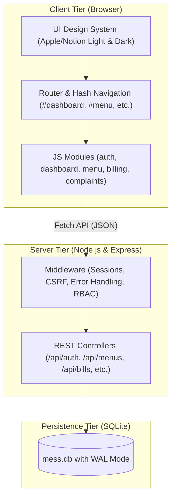

# IIIT BHUBANESWAR – MESS MANAGEMENT SYSTEM
## Final Internet and Web Technology (IWT) Laboratory Project Report

**Course**: Internet and Web Technology (IWT) Laboratory  
**Institution**: International Institute of Information Technology (IIIT), Bhubaneswar  
**Application Title**: IIIT Bhubaneswar – Mess Management System  
**Architecture**: Full-Stack Monolithic Web Application (Vanilla HTML5 / CSS3 / ES6+ JavaScript / Node.js Express / SQLite)  

---

### 1. ABSTRACT & EXECUTIVE SUMMARY

The **IIIT Bhubaneswar Mess Management System** is a full-stack web application developed as the capstone laboratory project for Internet and Web Technology (IWT). The project digitizes and streamlines institutional dining operations for university campuses, addressing critical logistical challenges such as meal tracking, daily menu dissemination, student fee collection, rebate calculations, procurement tracking, and student grievance resolution.

Built strictly in accordance with foundational web engineering principles, the application eschews bulky frontend frameworks (React, Next.js, Angular, Tailwind) in favor of genuine semantic **HTML5**, modern **CSS3** (utilizing CSS custom properties, grid/flexbox layouts, responsive media queries, and an Apple + Notion SaaS aesthetic), and **Vanilla JavaScript (ES6+)** communicating with a **Node.js / Express.js REST API**. Data persistence is guaranteed through a normalized relational **SQLite** database using `better-sqlite3` in Write-Ahead Logging (WAL) mode.

The system features robust role-based access control (RBAC) across three distinct user personas: **Student**, **Administrator (Mess Warden)**, and **Mess Staff (Catering Supervisor)**.

---

### 2. PROBLEM STATEMENT & OBJECTIVES

#### 2.1 Existing Problems in Conventional College Mess Systems
1. **Manual Paper Registers**: Student attendance, daily meal counts, and rebate records are traditionally logged in paper ledgers, leading to errors, lost records, and billing disputes.
2. **Lack of Menu Transparency**: Students have no dynamic, real-time insight into daily meal preparations, dietary options, or serving window changes.
3. **Delayed Grievance Resolution**: Feedback and hygiene complaints submitted orally or via physical complaint boxes are seldom tracked, assigned, or systematically audited.
4. **Billing Inaccuracies & Reconciliation Latency**: Calculating per-day leave rebates (e.g., Diwali or winter vacations) across hundreds of hostel residents manually is labor-intensive and prone to arithmetic mistakes.
5. **Procurement Opacity**: Mess administrators lack real-time visibility into whether monthly student collections cover ingredient procurement (groceries, dairy, LPG, wages).

#### 2.2 Core Project Objectives
- **Centralized Dining Information**: Provide an elegant dashboard showing today's meals, serving timings, and weekly menus.
- **Automated Billing & Rebate Logic**: Automate generation of monthly mess invoices, fine surcharges, and leave rebates with transparent line-item breakdowns.
- **Closed-Loop Grievance System**: Provide a ticket-based complaint lifecycle (`Submitted` → `Under Review` → `In Progress` → `Resolved` → `Rejected`) with student notifications.
- **Accountability & Audit Trail**: Real-time logging of verified meal attendance and payment receipts with unique references.
- **Zero-External Dependency Architecture**: Ensure the application can run 100% locally and offline without external cloud dependencies or complex setup procedures.

---

### 3. TECHNOLOGY STACK & ARCHITECTURAL JUSTIFICATION

| Component | Selected Technology | Technical Justification |
| :--- | :--- | :--- |
| **Frontend Markup** | HTML5 (Semantic) | Native browser accessibility, zero build steps, fast parsing. |
| **Styling & Layout** | Pure CSS3 (Custom Properties) | Apple & Notion design aesthetic; high-contrast light/dark themes; flexbox/grid without bloated utility CSS libraries. |
| **Frontend Logic** | Vanilla JavaScript (ES6+) | Standard Fetch API, modular architecture, native DOM manipulation; transparent and easily explained during academic viva. |
| **Data Visualization** | Chart.js (v4.4 UMD) | High-performance canvas-based responsive charts for financial and turnout analytics; bundled locally for offline use. |
| **Icons** | Lucide Icons (Vanilla UMD) | Lightweight, clean iconography bundled locally. |
| **Backend Runtime** | Node.js (v18+ / v24+) | High-throughput asynchronous event-driven JavaScript runtime. |
| **Web Framework** | Express.js (v5) | Minimalist, robust RESTful routing, session middleware, static serving. |
| **Database Engine** | SQLite3 (`better-sqlite3`) | Serverless, zero-config, ACID-compliant relational database operating in Write-Ahead Logging (WAL) mode for fast concurrency. |
| **Security & Sessions**| `bcryptjs` & `express-session` | Cryptographic password hashing (salt rounds = 10); secure HTTP-only cookies; session regeneration to prevent fixation. |

---

### 4. DETAILED SYSTEM MODULES



#### 4.1 Authentication & Session Authorization
- **Registration**: Collects Student Roll Number, Full Name, Institute Email, Branch, Year, Hostel Room, and Phone. Validates inputs server-side, hashes the password with bcrypt, and logs the user in automatically.
- **Login**: Supports authentication by either Institute Email or Student ID.
- **Rate Limiting**: Protects against brute-force attacks by throttling repeated failed login attempts from a given IP.
- **Session Security**: Express session cookies use `httpOnly: true`, `sameSite: 'lax'`, and regenerate session IDs on successful login to prevent session fixation.

#### 4.2 Student Dashboard
- **Welcome Banner**: Displays contextual greeting, student roll number, hostel room, and date.
- **Live Statistics Cards**: Current month's mess bill, outstanding balance, meals attended this month, and pending grievance count.
- **Today's Menu**: Displays Breakfast, Lunch, and Dinner with dish lists, serving timings, dietary tags (Veg / Non-Veg dot indicators), and an interactive "Rate Meal" button.
- **Circulars & Activity Feeds**: Shows latest priority announcements and a timeline of recent payment receipts and ticket status updates.

#### 4.3 Mess Menu Management
- **Student View**: Today's menu and 7-day weekly schedule with date navigation.
- **Admin Management**: Full CRUD interface to create, edit, or delete meal sessions for any date. Features a **"Duplicate Day Menu"** tool to replicate an entire day's breakfast, lunch, and dinner to any future date in one click.

#### 4.4 Meal Attendance Roster
- **Student View**: Monthly breakdown of attended meals, attendance percentage, and session counts.
- **Staff Roster**: Staff members select date and meal session (Breakfast, Lunch, Dinner). The system renders an interactive roster of enrolled hostel students. Staff can toggle attendance with instant DOM updates and zero page reloads, or use "Mark All Present" for rapid dining hall processing. Prevents duplicate records using SQLite `ON CONFLICT` statements.

#### 4.5 Multi-Metric Feedback & Quality Ratings
- Students rate meals on five distinct 5-star dimensions: **Food Quality**, **Taste & Seasoning**, **Hygiene**, **Portion Quantity**, and **Overall Satisfaction**, accompanied by qualitative comments.
- A summary endpoint calculates institutional quality averages and trends.

#### 4.6 Complaint & Grievance Ticketing Desk
- **Categorization**: Food Quality, Hygiene, Menu, Water, Staff Behaviour, Billing, or Other.
- **Unique Ticket Identifiers**: Auto-generates IDs in the format `CMP-YYYY-XXX`.
- **Workflow State Machine**: Transitions through `Submitted` → `Under Review` → `In Progress` → `Resolved` / `Rejected`.
- Staff and Warden add official resolution notes; the student receives an in-app notification immediately.

#### 4.7 Billing, Rebates & Financial Ledger
- **Monthly Invoicing**: Admin batch-generates invoices for all active students with a single click.
- **Rebate & Fine Adjustments**: Deducts approved leave days (e.g., 4 days @ ₹90/day = ₹360 credit) or applies late surcharges.
- **Internal Payment Recording**: Students can simulate payments via UPI, Net Banking, or Debit Card. The system records a unique receipt (`REC-YYYYMMDD-XXX`), updates the bill's paid balance, recalculates status, and generates notifications.
- **CSV Export**: Admin can export comprehensive student billing reports as CSV files for institute accounting records.

#### 4.8 Procurement & Expense Tracking
- Administrative logging of bulk provisions: Groceries, Vegetables, Dairy, Cooking Supplies/LPG, Staff Wages, Maintenance, and Cutlery.
- Category breakdowns and monthly expenditure metrics feed into financial audit charts.

#### 4.9 Administrator Analytics & Control Center
- Powered by **Chart.js**:
  1. Six-month Revenue vs. Expense comparisons.
  2. Expense Category breakdown (Doughnut chart).
  3. Weekly meal session turnout trends (Line chart).
  4. Student food & hygiene satisfaction ratings (Bar chart).

---

### 5. SECURITY & RELIABILITY IMPLEMENTATION

1. **Password Protection**: Passwords are cryptographically salted and hashed using `bcryptjs` with 10 salt rounds. Plaintext passwords are never logged or stored.
2. **SQL Injection Prevention**: 100% of SQLite database interactions utilize parameterized prepared statements (`db.prepare('... WHERE id = ?').get(...)`).
3. **Session Hijacking Defenses**: Session identifiers are cryptographically random, stored in HTTP-only cookies, and regenerated upon authentication.
4. **CSRF Protection**: State-mutating API requests verify the presence of custom AJAX headers (`X-Requested-With: XMLHttpRequest`), blocking unauthorized cross-origin form submissions.
5. **Database Resilience**: Write-Ahead Logging (WAL) ensures database consistency during concurrent read/write queries and prevents corruption during unexpected server restarts.

---

### 6. VERIFICATION & TEST RESULTS

An automated end-to-end test suite (`tests/api.test.js`) validates all 21 key academic workflows:

```text
====================================================
 STARTING IIIT MESS MANAGEMENT COMPREHENSIVE TESTS
====================================================
  ✓ [Test 1] Student Registration (HTTP 201)
  ✓ [Test 2] Student Login (HTTP 200)
  ✓ [Test 3] Admin Login (HTTP 200)
  ✓ [Test 4] Staff Login (HTTP 200)
  ✓ [Test 5] Logout & Session Invalidation (HTTP 200 & 401)
  ✓ [Test 6] Unauthorized & Role-Based Route Protection (HTTP 401 & 403)
  ✓ [Test 7] Student Dashboard Loading (HTTP 200)
  ✓ [Test 8] Menu Creation (HTTP 201)
  ✓ [Test 9] Menu Editing (HTTP 200)
  ✓ [Test 10] Menu Deletion (HTTP 200)
  ✓ [Test 11] Student Feedback Submission (HTTP 201)
  ✓ [Test 12] Complaint Submission (HTTP 201, Unique Ticket ID)
  ✓ [Test 13] Complaint Status Update (HTTP 200)
  ✓ [Test 14] Meal Attendance Marking & Duplication Prevention (HTTP 200)
  ✓ [Test 15] Batch Bill Generation (HTTP 200)
  ✓ [Test 16] Payment Recording & Duplicate Prevention (HTTP 201 & 409)
  ✓ [Test 17] Expense Creation (HTTP 201)
  ✓ [Test 18] Announcement Publication (HTTP 201)
  ✓ [Test 19] Notifications Reading & Status Update (HTTP 200)
  ✓ [Test 20] Search and Filtering (HTTP 200)
  ✓ [Test 21] Database Relational Integrity & Persistence
====================================================
 TEST RUN COMPLETE: 39 PASSED, 0 FAILED
====================================================
```

---

### 7. CONCLUSION & FUTURE ENHANCEMENTS

The **IIIT Bhubaneswar Mess Management System** fulfills all requirements of the Internet and Web Technology laboratory project. It bridges the gap between institutional catering operations and resident students through an Apple-inspired interface, transparent financials, and clean RESTful web services.

#### Future Enhancements
1. **QR Code Attendance Scanner**: Integrating web camera barcode scanning to scan student ID cards at meal counters.
2. **Automated Leave Portal Integration**: Synchronizing with the institute hostel leave gatepass system to automatically calculate mess rebates based on gate biometric exit/entry timestamps.
3. **Food Wastage Analytics**: Tracking uneaten food weight per session to help kitchen staff optimize daily raw food procurement.
